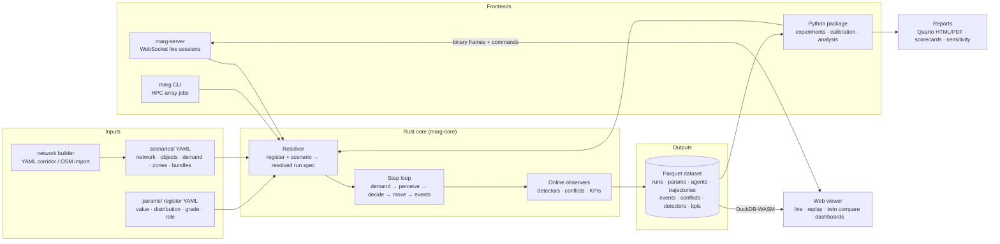

# 02 · Tech stack and high-level architecture

**Decision.** The simulator is a Rust core, wrapped three ways:

- a static CLI binary for HPC sweeps;
- a Python package (PyO3) for experiments, calibration and analysis;
- a WebSocket server feeding a TypeScript web viewer for live runs and replays.

All research output is Parquet. One schema, written in Rust, generates the Python and TypeScript types,
so the three sides cannot drift apart.

## At a glance



## Tech stack

| Layer | Choice | Why | Rejected alternatives |
| --- | --- | --- | --- |
| Simulation core | **Rust** (stable), Cargo workspace | C++-level speed with memory safety, which matters when much of the code is AI-written. Easy static binaries for clusters | C++ (undefined-behaviour risk), Python+Numba (branch-heavy agent logic is slow, hard to keep fast), Julia (small ecosystem for web and GIS) |
| Data parallelism | `rayon` | Work-stealing; easy to keep deterministic with a two-phase update | Hand-rolled threads |
| RNG | Counter-based streams (`rand` + `rand_chacha`, stream key = seed × kind × entity) | Same agent, same draws in any scenario arm (common random numbers), whatever the thread count | One global RNG (order-dependent, breaks twins) |
| Config schema | `serde` + `schemars` → JSON Schema → pydantic (Python) and TypeScript types | One source of truth for the register, scenarios, the UI parameter panel and validation | Hand-mirrored types in three languages |
| Output | Apache Arrow + Parquet (`arrow-rs`, `parquet`, zstd) | Columnar, typed, compressed. Opens directly in Polars, DuckDB, pandas, R and MATLAB | CSV (size, types), HDF5 (weak in web and SQL tools), XML (SUMO's 5× size) |
| Python bindings | PyO3 + maturin, abi3 wheels | `pip install` on laptop and cluster; zero-copy Arrow handoff to Polars | ctypes or cffi |
| Python env | `uv`, Python ≥ 3.11 | Fast, lockfiles, reproducible on HPC | conda (slow, heavy) |
| Analysis | Polars + DuckDB | Fast on multi-GB run sets; SQL over Hive-partitioned Parquet | pandas only (memory) |
| Sensitivity and calibration | SALib (Morris, Sobol), scikit-learn GP surrogates, pyabc (ABC-SMC), optuna or CMA-ES (point fits), `sbi` optional | Covers guide §8 end to end; Bayesian methods per Platt (2020) | Writing samplers ourselves |
| Reports | Quarto (Jupyter engine) + matplotlib house style | Academic HTML and PDF from one template; figures and LaTeX tables ready for papers | Ad hoc notebooks |
| Live server | `axum` + `tokio` WebSockets, inside the Rust workspace | Streams binary frames from the running sim without a Python hop | FastAPI wrapper (an extra copy per frame) |
| Web viewer | TypeScript, React, Vite; **deck.gl** (instanced, binary attributes); MapLibre basemap for zones; **uPlot** for streaming series; ECharts for histograms and heatmaps | deck.gl draws tens of thousands of oriented rectangles at 60 fps and handles map and metric coordinates; uPlot is the fastest live chart library | Canvas2D (too slow at zone scale), Three.js (more custom code) |
| Replay in browser | DuckDB-WASM + Arrow JS on the run's Parquet | Open any run folder with no server; filter by persona or class with SQL in the browser | A custom replay format |
| HPC | Static `marg` binary (musl) or Apptainer image; SLURM array templates; local process pool on laptops | Clusters rarely let you build Rust; a single file copies over | Docker (often banned on HPC) |
| CI | GitHub Actions: fmt, clippy, tests, determinism, benchmarks, wheel build, web build | Catches regressions in AI-written changes | — |

Working name: `marg` (मार्ग, "road"). Crates are `marg-*`, the Python package is `marg`, the CLI is
`marg`. Renaming is cheap until Phase 2 ([open questions](open-questions.md)).

## Repository layout (target)

```
traffic-simulator/
  plan/                  ← this planning folder
  crates/
    marg-params/         parameter register types, distributions, sampling, schema export
    marg-net/            ribbons, junctions, road objects, zone fields, network build
    marg-core/           agent store, step loop, behaviour modules, observers
    marg-io/             Arrow/Parquet writers, manifest, data dictionary
    marg-cli/            headless runner: run, batch, validate, params, build-network
    marg-server/         live WebSocket sessions
    marg-py/             PyO3 bindings (built by maturin into python/marg)
  python/marg/           scenario API, experiments, hpc, analysis, calibration, sensitivity, reports
  web/                   viewer (live, replay, compare, dashboards)
  params/base/           the register from guide §9, one YAML per group
  scenarios/             corridors, junction cases, validation cases, zone studies
  validation/targets/    pattern-oriented validation targets (guide §9.8) as YAML
  reports/               Quarto templates
  benches/               criterion benchmarks + reference scenarios
```

## Core design

### 1. Space: ribbons, not lanes

The road is a graph of **ribbons**. A ribbon is a reference polyline with arc length `s`, plus a
lateral coordinate `y` bounded by a width profile `[y_min(s), y_max(s)]`.

- **Ribbon kinds.** Links are ribbons. Each turning movement inside a junction is also a ribbon. Where
  movement ribbons overlap, a *conflict area* forms.
- **Agent position.** Each agent stores `(ribbon, s, y, v_s, v_y, heading)`. This frame keeps
  lane-free behaviour simple: lateral position is a continuous number in metres, so there are no
  strips.
- **Strips.** Footpaths, service roads and the opposite carriageway are separate strips with access
  flags. Footpath riding, wrong-way riding and opposite-lane encroachment are just moves onto a strip
  the agent is not meant to use.
- **Road objects** (potholes, parked vehicles, vendors, bus stops, humps, waterlogged patches, work
  zones) are positioned in `(s, y)` with a footprint. They act only through four channels: usable
  width, local speed caps, gap supply and violation incentives (guide §6). The step loop has **no**
  capacity-multiplier hook, so a "−30% capacity" shortcut cannot be written.
- **Zones** are sets of ribbons carrying zone parameters. Spatial fields such as the enforcement halo
  are precomputed onto ribbons as arrays sampled along `s`.
- **Coordinates.** World coordinates are metric (UTM 43N, EPSG:32643 for Delhi), so OSM imports and
  basemaps line up.

### 2. Agent store: struct-of-arrays

Agents live in contiguous column arrays: position, velocity, dimensions, class, persona, traits,
per-agent drawn parameters, route and state flags. IDs are generational, and dead slots are compacted
periodically.

- **Why columns.** The hot loop touches a few columns for every agent, so this layout is
  cache-friendly and SIMD-friendly. It also maps one-to-one onto Arrow output columns.
- **Numbers.** State is `f64` in the core and is down-cast to `f32` only for streaming to the viewer.
  We revisit this after the benchmarks.

### 3. Neighbour search

- **Within a ribbon:** agents are kept sorted by `s`. The order is nearly unchanged between steps, so
  insertion sort costs O(n). Leaders, followers and side neighbours are found by scanning a window in
  `s` and filtering on lateral overlap.
- **Across ribbons** (junction interiors, pedestrians, merges): a uniform world grid hash.
- **Caching:** the neighbour sets are computed once per step and shared by every module (following,
  lateral, imitation counts, conflicts).

### 4. Step loop: multi-rate and two-phase

Fixed `Δt = 0.1 s` (configurable). Each step runs in this order:

1. **Demand:** spawn agents from the arrival processes.
2. **Perceive (parallel, read-only):** build neighbour sets; sample zone fields; update the
   detection of road objects.
3. **Decide (parallel, read-only, lower rate):** route and strategic choices, lateral target choice and
   violation decisions run every `Δt_dec` (default 0.5 s, staggered by agent ID). They run sooner when
   an event fires, e.g. a signal change or a deadline approaching.
4. **Move (parallel, read-only):** compute longitudinal and lateral accelerations from the
   current snapshot.
5. **Apply (sequential or chunked):** ballistic integration, ribbon transitions, constraint and
   collision guard.
6. **Observe:** detectors, conflicts, events and KPIs are aggregated in streaming form. Outputs go to a
   writer thread.
7. **Commands:** live parameter changes and object edits are applied at the step boundary, and every
   one is logged.

Steps 2 to 4 only read the previous state and write per-agent buffers. That makes the result
bitwise-identical for any thread count, which is tested in CI. Exponentials and logs in decision
code use the `libm` crate, so results also match across machines.

### 5. Behaviour modules

Each mechanism in the guide is a module behind a small trait, with its own parameters, tests and
output columns:

| Module | Guide § | Trait |
| --- | --- | --- |
| Longitudinal following (IDM family, leader chosen by lateral overlap, pair multipliers) | 2.1 | `Longitudinal` |
| Lateral movement (clearance, target choice, steering repulsion, heading limit) | 2.2 | `Lateral` |
| Gap acceptance and forced entry | 2.4, 6.7 | `GapAcceptance` |
| Traits, personas and within-trip κ dynamics | 3 | `TraitModel` |
| Violation decisions and the catalogue | 4 | `Violation` (one implementation per type) |
| Imitation counts | 4.3 | inside the decision context |
| Signals and control states | 6.6 | `Controller` |
| Road-object responses | 6.1–6.11 | `ObjectResponse` |
| Pedestrians and animals | 6.4–6.5 | separate agent kinds that share the neighbour grid |
| Demand and arrivals | 7 | `ArrivalProcess`, `CompositionProfile` |

The exact equations are in [03-model-design.md](03-model-design.md).

### 6. Parameters: register → resolver → run

- **Register entries.** Every number lives in `params/base/*.yaml` as a typed entry: value or
  distribution, unit, grade (A/B/C), role (Fix/Fit/Sweep/Check), calibration stage, source, a
  live-tweakable flag and allowed range.
- **Resolution.** A scenario overrides entries, and an experiment sets sweep values. The **resolver**
  produces a resolved run spec, writes it to the run folder and hashes it. That hash is the run's
  identity.
- **No magic numbers.** Model code reads parameters only through typed handles generated from the
  register. A CI test fails on any unregistered behaviour constant, and on any register entry nothing
  uses (guide rule: "if it changes nothing, drop it").
- **Stage freezing.** The calibration API can only write entries whose role is `Fit` *and* whose stage
  is the one being calibrated. Earlier stages are read-only. That turns the guide's "never re-open an
  earlier stage" rule into code.

### 7. Outputs and observers

See [04-data-outputs-analytics.md](04-data-outputs-analytics.md). In short:

- Observers aggregate online, so a sweep run can skip trajectories entirely and still produce every
  KPI and validation pattern.
- Trajectories are opt-in: chosen rate (10 Hz, 1 Hz or off) and spatial windows.

### 8. Frontends

- **CLI** (`marg`): `run`, `batch` (reads a JSONL run list; skips runs already done, by hash),
  `validate`, `params list|explain`, `build-network`, `serve`. One static binary; this is what HPC
  array jobs call.
- **Python** (`marg`):
  - `Scenario`, `run()`, `Experiment`, designs (factorial, LHS, Morris, Saltelli), backends (local
    pool, SLURM);
  - `analysis` (metrics, patterns), `calibrate` (staged), `report`;
  - Arrow results returned zero-copy as Polars frames.
- **Live server** (`marg serve`): one sim thread per session.
  - Commands arrive over WebSocket: play, pause, step, speed, set parameter, toggle signal state,
    add or remove object, select agent, set a breakpoint.
  - Frames go out as Arrow IPC binary: id, x, y, heading, class and one colour value, decimated to the
    viewer frame rate and culled to the viewport.
  - KPI frames go out at 1 Hz.
  - A live session is saved as *scenario + seed + timed command log*, so anything seen in the UI can
    be re-run headless and bitwise identical.

### 9. Web viewer

Four views share one canvas and one store:

- **Live:** play, pause, step, time warp; colour by attribute; agent inspector with decision
  explanation; event breakpoints.
- **Parameter panel:** generated from the JSON Schema, grouped like the register, with grade and role
  badges.
  - Population-level parameters (β coefficients, enforcement, signal state, demand) change
    immediately.
  - Per-agent drawn parameters (desired speed etc.) apply to new arrivals, or to everyone with
    "resample".
- **Replay:** open a run folder or URL; scrub time; filter with SQL (DuckDB-WASM); trails; heatmaps;
  time–space diagram.
- **Compare:** two twin runs in sync, side by side or overlaid, with a KPI difference strip.

A dashboard rail shows throughput, delay (mean and p95), density, violations by type, conflicts and
the gridlock indicator. It also shows lateral-position and speed histograms per class, and the
fundamental diagram.

## Performance targets

These are checked by benchmarks from Phase 2 (`marg bench`, `cargo bench`). Throughput is measured
in agent-steps per second. *Correction from implementation:* 3,000 agents on 2 km is about
1,500 veh/km, above jam density for a 10.5 m road (about 800 veh/km in the Chennai data), so the
corridor budget is stated per agent-step instead.

| Case | Size | Target | Measured (P2, one laptop-class core) |
| --- | --- | --- | --- |
| Corridor, headless, KPIs only | budget: ≤ 555 ns per agent-step (= 1 h of 3,000 agents in 60 s) | ≤ 60 s on 1 core; stretch ≤ 20 s | ~90 ns/agent-step; reference corridor (2 km, ~400 agents at once) 1 h in 1.2 s |
| Corridor with 1 Hz trajectories | same | ≤ 1.3× the headless time | within target |
| Zone, multi-threaded | ~50 junctions, ~20,000 agents | ≥ 10× real time on 8 cores |
| Live viewer | zone case | 30 fps rendering at 1× to 5× real time |

**Budget check.** A Sobol run on 15 parameters with N = 1,024 needs 1,024 × 17 = 17,408 parameter
sets. With 5 replications that is ~87,000 runs: about 1,450 core-hours at 60 s per run, or about 480
at the 20 s stretch target. That is fine on a cluster and too much for a laptop. So the plan
**screens with Morris first** and uses **GP surrogates** (guide §8.4), and run-level parallelism (one
run per core) is the default for sweeps.

## Quality gates (every change)

1. `cargo fmt --check`, `cargo clippy -D warnings`, `cargo test`; `pytest`; web `tsc` and tests.
2. **Determinism:** the reference scenario gives the same output hash with 1 thread and with N
   threads, and on rerun.
3. **Benchmarks:** the reference corridor gets no more than 5% slower than the `main` baseline.
4. **Mechanism tests:** each module has micro-scenario tests (see each phase card).
5. **Register integrity:** no unregistered constants and no unused entries.
6. **Data dictionary:** regenerated and committed whenever an output schema changes.
