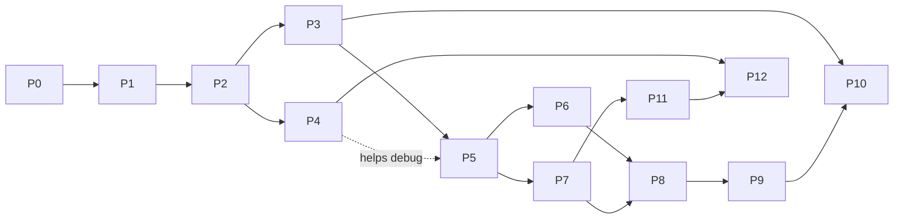

# 05 · Phase-wise roadmap

**Build in 13 phases.** The research tooling comes first (P0–P4): register, corridor physics,
experiment runner, reports and viewer. Then the guide's mechanisms are added in its own order of
priority and calibration (P5–P9). Real-data calibration (P10) and network scale-up (P11) follow.
Every phase ends with a **milestone check** — a result that means something for the research, not
just "code compiles". Every phase also ships its own metrics, tests and report section.

Each phase has a task card in [phases/](phases/). A task is sized for one focused AI session, or a
few. Progress is tracked in [STATUS.md](STATUS.md).

## Phases

| Phase | What it builds | Guide § | Calibration stage | Milestone check | Size |
| --- | --- | --- | --- | --- | --- |
| [P0](phases/P00-foundations.md) Foundations | Workspace, CI, schema pipeline, RNG streams, empty step loop, CLAUDE.md | — | — | Empty sim is deterministic across thread counts; a wheel installs | S |
| [P1](phases/P01-parameter-register.md) Register and scenario schema | Typed register, distributions, §9 transcribed, resolver, run hash | 9, 8.1 | 0 | `marg params list --grade C --role Sweep` matches guide §9 | M |
| [P2](phases/P02-corridor-core.md) Corridor core | Ribbons, 14 vehicle types, IDM with lane-free leader set, demand, detectors, Parquet, benchmarks | 1, 2.1, 7.1–7.3 | 1–2 | Free-flow speed pattern by sub-class reproduced; corridor perf target met | L |
| [P3](phases/P03-experiments-analytics.md) Experiments, analytics, reports v1 | Experiment manager, twin arms, SLURM backend, SALib, stage-freeze API, Quarto reports | 8 | tooling | Morris screen of P2 parameters run on HPC, report rendered | L |
| [P4](phases/P04-web-viewer.md) Web viewer v1 | Live server, deck.gl viewer, schema-driven parameter panel, replay, twin compare | — | — | Change `v0` mean live and watch the fundamental diagram move; replay of a P3 run | L |
| [P5](phases/P05-lateral-interaction.md) Lateral behaviour and conflicts | Clearance model, target choice, steering, filtering and seepage, 2-D TTC conflicts | 2.2, 4.4 | 3 | E-rickshaw moving bottleneck passed on both sides; lateral histograms plausible; zero guard collisions | L |
| [P6](phases/P06-road-objects-side-friction.md) Road objects and side friction | Parking, stop-anywhere, bus stops, potholes, humps, gradients, waterlogging, midblock pedestrians | 6.1–6.5, 6.8–6.10 | 5 | Varanasi ≈1:1 width–capacity curve emerges untuned; ~200 ped/h threshold | L |
| [P7](phases/P07-junctions-splits.md) Junctions, splits, gap acceptance | Movement ribbons, conflict areas, fixed signals and countdowns, uncontrolled junctions, median openings, splits with deadlines | 2.4, 6.6, 6.7 | 4 | Late realisers at a split create voids and stoppages; accepted-gap distributions by class | L |
| [P8](phases/P08-personas-violations.md) Personas, violations, imitation | Trait space, personas, OU κ, decision engine, violation catalogue, imitation both ways, signal control states | 3, 4, 6.6 | 6–7 | Dark-signal vs working-signal twin experiment across aggressive-persona share | L |
| [P9](phases/P09-zones-bundles.md) Zones and scenario bundles | Enforcement fields, zone profiles, population swap, rain, night, fog, GRAP, EV bundles, animals, work zones | 5, 6.5, 6.10–6.11, 7.4–7.7 | 7 | Population-swap 2×2×2 (geometry × population × enforcement) with decomposition report | M |
| [P10](phases/P10-calibration-campaign.md) Calibration and validation campaign | Staged fit on real data, recovery tests, Morris → Sobol, held-out scorecard | 8 | 1–7 | Scorecard on held-out patterns | L (data-bound) |
| [P11](phases/P11-network-scale.md) Network scale-up | OSM importer, multi-junction zones, fixed then optional route choice, parallel tuning | 7.5 | — | Zone of ~50 junctions at ≥10× real time on 8 cores | L |
| [P12](phases/P12-editor-polish.md) Editor and polish | Web scenario editor, video export, docs site, packaging | — | — | A new corridor built and run with no YAML editing | M |

Sizes are relative effort: S ≈ a few sessions, M ≈ 1–2 weeks, L ≈ 2–4 weeks of part-time
AI-assisted work.

## Dependencies and parallel tracks

- **Viewer and analytics:** once P2 lands, P3 and P4 can run in parallel on separate branches.
- **Road objects and junctions:** once P5 lands, P6 and P7 are independent.
- **Calibration** is a *track*, not a final step. A calibration stage can start as soon as both its
  mechanism phase and its data exist (e.g. stage 1 needs early-morning video and P2). The plan
  puts it at P10 only for the full held-out scorecard.

## Why this order

1. **Tooling before behaviour.** Lateral behaviour (P5) is the hardest and most important mechanism,
   and it cannot be judged without detectors, trajectories, the viewer and experiment reports. Those
   come first.
2. **Physical before social** (guide §8.3). Each mechanism phase lines up with a calibration stage, and
   the freeze rule is enforced in code from P3.
3. **The guide's road-situation priority** (§6.12):
   - side friction first, because it has the best Indian data (P6);
   - then splits (P7);
   - then signal states (P8);
   - then potholes, pedestrians and bundles.

   Potholes move into P6 because they share the object machinery.
4. **Research results early.** Each of P6–P9 ends with a publishable-style experiment: the width
   curve, split voids, dark-signal Chicken, and the population swap.

## Definition of done (every phase)

- All task acceptance checks pass, plus the global quality gates in
  [02-architecture.md](02-architecture.md#quality-gates-every-change).
- New parameters are in the register with grade, role, stage and source.
- New outputs are in the data dictionary.
- A short phase report exists under `reports/phases/Pn.qmd`, with its milestone check rendered.
- [STATUS.md](STATUS.md) is updated, and any design choice is recorded as an ADR.
