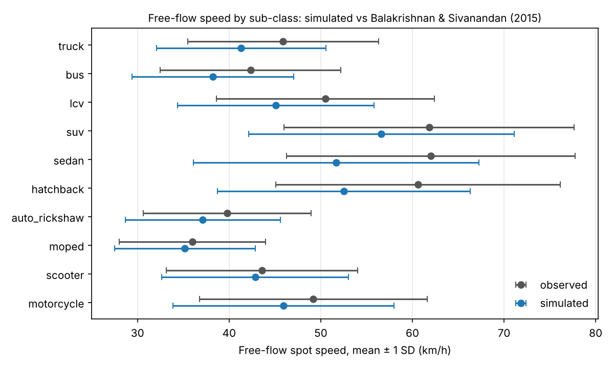

# P2 milestone: free-flow speed by sub-class

**2 of 10 sub-classes match the stage-1 target** within ±2.0 km/h on the mean and ±2.0 km/h on the SD, with no parameter tuned (5 seeds; 1398 free crossings of 2913 at the 750 m screenline after warm-up).

A crossing counts as *free* when no vehicle close enough laterally to interact (within the speed-dependent clearance plus the interaction cutoff) crossed in the preceding 8 s, mirroring how field studies select free-flowing vehicles. The 8 s threshold is an assumption to check against the source paper.

Scenario: `scenarios/free_flow_early_morning.yaml` (300 veh/h on 1.5 km x 10.5 m). Target: `validation/targets/patterns.yaml#free_flow_speed_by_subclass` (Balakrishnan & Sivanandan 2015). Regenerate with `uv run python scripts/p2_milestone.py`.

| Sub-class | Free crossings | Observed mean (km/h) | Simulated mean, free | Simulated mean, all | Mean drawn v0 | Observed SD | Simulated SD, free | Result |
| --- | --- | --- | --- | --- | --- | --- | --- | --- |
| motorcycle | 222 | 49.19 | 45.92 | 41.33 | 46.11 | 12.43 | 12.07 | fail |
| scooter | 246 | 43.60 | 42.83 | 38.90 | 42.91 | 10.44 | 10.18 | pass |
| moped | 179 | 36.00 | 35.17 | 34.06 | 35.19 | 7.98 | 7.67 | pass |
| auto_rickshaw | 181 | 39.81 | 37.12 | 35.47 | 37.22 | 9.16 | 8.45 | fail |
| hatchback | 130 | 60.61 | 52.53 | 42.01 | 53.90 | 15.52 | 13.79 | fail |
| sedan | 87 | 62.00 | 51.68 | 40.95 | 52.35 | 15.76 | 15.59 | fail |
| suv | 66 | 61.82 | 56.61 | 43.22 | 57.22 | 15.85 | 14.51 | fail |
| lcv | 83 | 50.49 | 45.07 | 38.95 | 46.02 | 11.89 | 10.71 | fail |
| bus | 122 | 42.33 | 38.23 | 36.33 | 38.41 | 9.86 | 8.81 | fail |
| truck | 82 | 45.88 | 41.31 | 38.38 | 42.14 | 10.42 | 9.22 | fail |

## Reading it

- **The following model is right for free vehicles.** Free crossings travel at their own drawn desired speed: compare *Simulated mean, free* with *Mean drawn v0* (within 1.4 km/h for every sub-class).
- **The gap to the target is selection bias from the missing overtaking.** The free subset is biased toward slow drivers: fast drivers catch slower vehicles in their lateral band and, in P2, cannot move laterally to pass (lateral movement arrives in P5). So the drawn v0 of *free* hatchbacks averages well below the population mean. Wide-spread car classes fail most; the sub-classes that pass (scooter, moped) have narrower spreads, and which of them land inside ±2 km/h changes with the seeds' draws (P3.3 changed every agent's draws; this run passed 2, the previous one 3).
- **What happens next.** Re-run this check after P5, then let stage-1 calibration (P3.8, P10.2) fit the `vehicles.free_flow_speed.*` and `vehicles.median_band.*` parameters jointly. Nothing is tuned here.

Mean KPIs over seeds: network speed 35.6 km/h, mean delay 35.0 s, collision-guard events 0.
