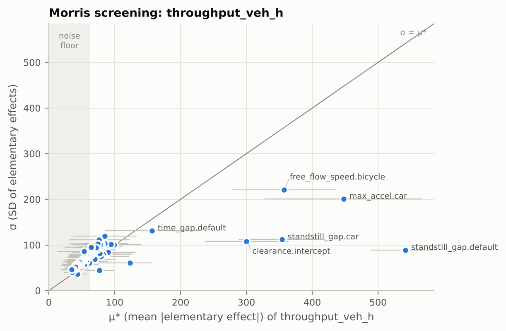
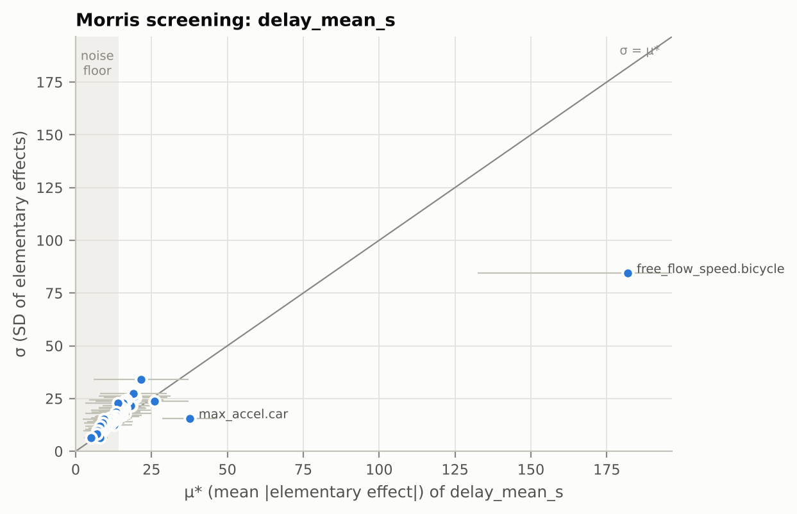

# P3 milestone: Morris screen of the P2 fit parameters on corridor capacity

**58 factors, 590 design points x 2 replications = 1180 runs** of `scenarios/corridor_capacity.yaml`: 64 CPU-minutes of simulation (about 16 min on 4 local workers). 1180 of 1180 runs finished `ok`. Nothing was tuned.

The scenario is the P2 reference corridor (2 km, 10.5 m, Delhi-arterial composition) with demand above capacity (4,500 veh/h). A queue forms at the entry, so the throughput at s1900 after the 600 s warm-up is the corridor's discharge capacity.

## Setup

- **Factors:** every `fit` parameter the P2 core reads, for the vehicle types in the composition (parameters of absent types cannot have an effect): desired speeds (per type), the median-band bonus, minimum entry headways, IDM `T`, `s0`, `a`, `b` (per class), the two leader–follower multipliers, and the three lateral-weighting parameters (clearance intercept and slope, braking scale) that decide which vehicles count as leaders.
- **Bounds:** the base value's mean x (1 ± 25%), clipped to the register range. Distribution-valued parameters move their mean at a fixed coefficient of variation (ADR-0006). The register ranges themselves are hard validity limits, too wide for a screen (e.g. 3–130 km/h for a desired speed).
- **Design:** Morris, 10 trajectories, 4 levels, seed 1; 2 replications per point with common random numbers (replication `r` uses seed `1 + r` at every point), averaged before the analysis.
- **Outputs:** `throughput_veh_h`, `delay_mean_s`, `delay_p95_s`, `network_mean_speed_m_s`.

## Capacity across the design

Throughput at s1900: mean 2767 veh/h, range 2087–3617 veh/h over all runs (P2 base parameters: about 2,750 veh/h).

## Which parameters matter for capacity

Top factors by μ*, the mean absolute elementary effect on throughput in veh/h per factor's whole screening range (SALib divides each output change by the step as a fraction of the range, 2/3 for a 4-level grid); `mu_star_conf` is its bootstrap 95% half-width:

| factor | mu_star | mu_star_conf | sigma | mu_star_rel |
|---|---|---|---|---|
| interaction.following.pair_multiplier.standstill_gap.default | 541.5 | 53.83 | 88.81 | 1 |
| interaction.following.max_accel.car | 447.5 | 120 | 201.1 | 0.8263 |
| vehicles.free_flow_speed.bicycle | 357.1 | 78.77 | 220.4 | 0.6595 |
| interaction.following.standstill_gap.car | 354 | 65.71 | 111.9 | 0.6536 |
| interaction.lateral.clearance.intercept | 300.2 | 63.93 | 107.9 | 0.5544 |
| interaction.following.pair_multiplier.time_gap.default | 156.6 | 71.4 | 131.3 | 0.2892 |
| interaction.lateral.braking_scale | 123.6 | 33.66 | 60.29 | 0.2282 |
| interaction.following.max_accel.auto_rickshaw | 99.36 | 41.96 | 100.5 | 0.1835 |
| interaction.following.comfortable_decel.car | 94.32 | 39.99 | 101.4 | 0.1742 |
| interaction.following.max_accel.two_wheeler | 90.09 | 38.62 | 82.31 | 0.1664 |
| interaction.following.time_gap.car | 89.82 | 41.7 | 84.42 | 0.1659 |
| vehicles.free_flow_speed.truck | 85.05 | 48.07 | 119.7 | 0.1571 |
| vehicles.free_flow_speed.sedan | 84.6 | 36.02 | 103.3 | 0.1562 |
| interaction.following.standstill_gap.two_wheeler | 82.08 | 42.37 | 80.05 | 0.1516 |
| interaction.following.standstill_gap.e_rickshaw | 79.74 | 36.46 | 101.9 | 0.1472 |

By parameter group (the strongest member, relative μ* on throughput):

| group | max_rel | top factor | factors |
|---|---|---|---|
| pair_multiplier | 1 | interaction.following.pair_multiplier.standstill_gap.default | 2 |
| max_accel | 0.8263 | interaction.following.max_accel.car | 8 |
| free_flow_speed | 0.6595 | vehicles.free_flow_speed.bicycle | 12 |
| standstill_gap | 0.6536 | interaction.following.standstill_gap.car | 8 |
| intercept | 0.5544 | interaction.lateral.clearance.intercept | 1 |
| braking_scale | 0.2282 | interaction.lateral.braking_scale | 1 |
| comfortable_decel | 0.1742 | interaction.following.comfortable_decel.car | 8 |
| time_gap | 0.1659 | interaction.following.time_gap.car | 8 |
| min_headway | 0.1449 | demand.min_headway.car | 8 |
| slope | 0.1138 | interaction.lateral.clearance.slope | 1 |
| speed_bonus | 0.09872 | vehicles.median_band.speed_bonus | 1 |

## Screening summary

Every μ* carries simulation noise: even with common random numbers, changing a parameter changes the realisation. The noise floor is the μ* a factor with no effect would show, estimated from the spread of each elementary effect across the two replications (`marg.sensitivity.morris_noise_floor`):

| output | noise_floor | top_mu_star | floor_share_of_top |
|---|---|---|---|
| delay_mean_s | 14.26 | 181.9 | 0.0784 |
| delay_p95_s | 21.78 | 210.7 | 0.1034 |
| network_mean_speed_m_s | 0.0792 | 1.008 | 0.07855 |
| throughput_veh_h | 62.68 | 541.5 | 0.1158 |

With the floor at 63 veh/h for throughput, the screen sorts the 58 factors as follows (influential: μ* above twice the floor for at least one output; within noise: below the floor for every output; these cut-offs are reporting conventions, not model parameters):

- **Influential (7):** `vehicles.free_flow_speed.bicycle`, `interaction.following.pair_multiplier.standstill_gap.default`, `interaction.following.max_accel.car`, `interaction.following.standstill_gap.car`, `interaction.lateral.clearance.intercept`, `interaction.following.pair_multiplier.time_gap.default`, `vehicles.free_flow_speed.motorcycle`.
- **Unresolved (33):** above the floor for some output but not by a factor of two; more replications (the floor shrinks as 1/√R) or more trajectories would separate them.
- **Within noise (18):** `interaction.lateral.clearance.slope`, `interaction.following.comfortable_decel.bus`, `interaction.following.comfortable_decel.two_wheeler`, `interaction.following.time_gap.lcv`, `interaction.following.standstill_gap.truck`, `interaction.following.max_accel.bicycle`, `vehicles.free_flow_speed.scooter`, `interaction.following.comfortable_decel.auto_rickshaw`, `demand.min_headway.auto_rickshaw`, `demand.min_headway.truck`, `vehicles.median_band.speed_bonus`, `vehicles.free_flow_speed.suv`, `interaction.following.max_accel.truck`, `interaction.following.time_gap.auto_rickshaw`, `demand.min_headway.e_rickshaw`, `interaction.following.max_accel.e_rickshaw`, `interaction.following.comfortable_decel.truck`, `interaction.following.standstill_gap.bicycle`.

This screen therefore identifies the few parameters that clearly drive capacity and delay; it does **not** yet justify fixing the rest, because at two replications the floor is a large share of the effects. Before choosing the stage-2 parameter set, repeat it with more replications (after P5).

μ*, σ, noise floor and signal-to-noise ratio for every factor and output: `reports/phases/P3_morris_screen.csv`.

## Reading it

- **Standstill gaps and car acceleration lead.** The shared standstill-gap multiplier and the car class's `s0` and `a` rank highest; the car time gap ranks well below its `s0`, and the shared time-gap multiplier below the shared standstill-gap one. A likely reason, not yet checked with a dedicated test: the queue enters from a standing start, where the standstill gap and acceleration dominate the IDM desired gap. Global multipliers outrank per-class parameters partly because they act on every pair.
- **The bicycle desired speed is most likely a P2 artefact.** Bicycles are 1% of vehicles, yet their desired speed ranks third on throughput: with no lateral movement, every bicycle is a moving bottleneck for the vehicles behind it in its band. Expect this to fall away once filtering and overtaking exist (P5).
- **The clearance intercept matters, its slope does not (yet).** The intercept decides which vehicles count as leaders at low speed, so it moves capacity even before lateral movement exists; the speed-dependent slope is within noise here, and the braking scale is unresolved. All three are stage-3 parameters, fitted after stage 2 (G§8.3).
- This is the P2 model: no lateral movement yet (P5), so a fast vehicle that catches a slow one in its lateral band stays behind it. Capacity is set by platoons behind the slowest vehicles, which is why slow-vehicle parameters can matter more here than they will once filtering and overtaking exist. **Re-run this screen after P5** before freezing the stage-2 parameter set.
- The ranking is local to the ±25% box around the current values. Parameters near zero here may still matter for outputs not screened yet (conflicts, gridlock onset: P7–P8).

## Reproduce

`uv run python scripts/p3_milestone.py` (writes the experiment to `runs/p3-morris-capacity/`, with the full sensitivity, experiment and parameter-appendix reports in its `report/` folder, HTML and PDF).
