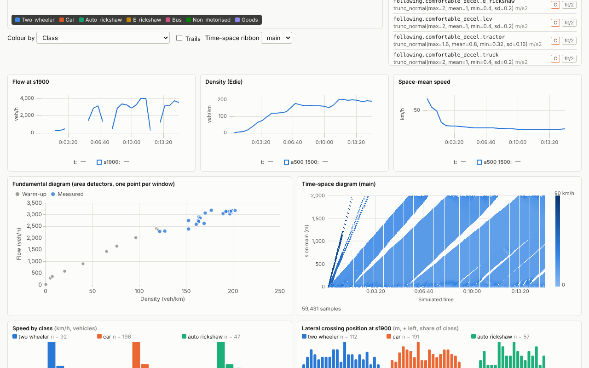
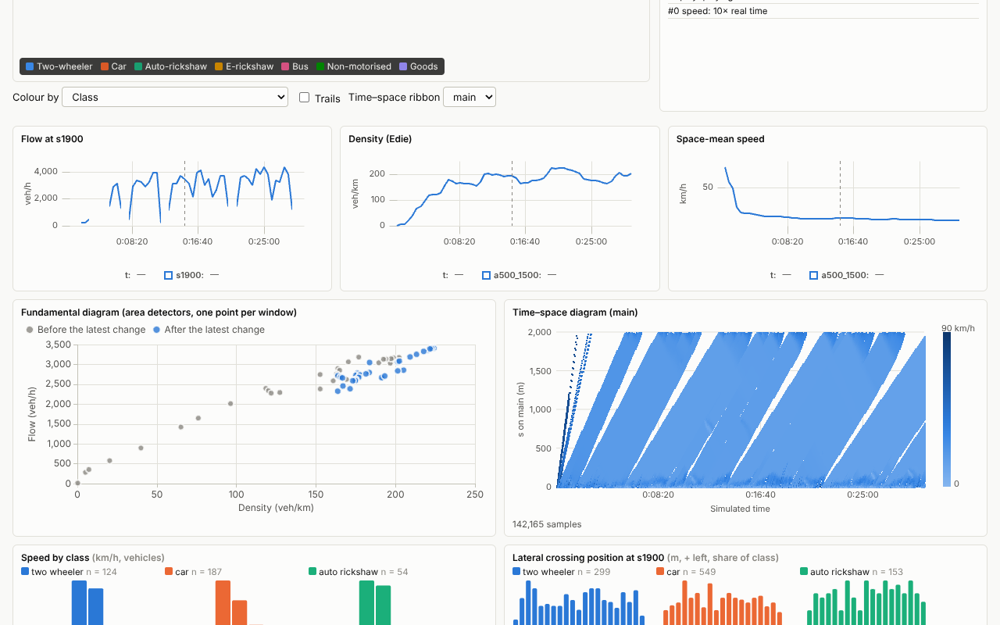
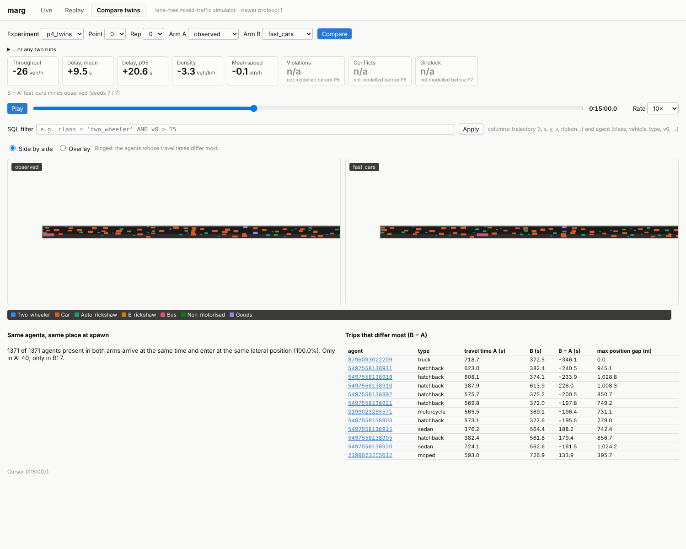

# P4: web viewer v1 (live, replay, compare)

All eight tasks of `plan/phases/P04-web-viewer.md` are implemented. This page gives each "Done
when" check with its evidence. Measurements come from a 4-core Xeon (2.1 GHz) cloud container
with release builds, on localhost. That container has **no GPU**: the browser checks ran in
headless Chromium with software WebGL (SwiftShader). **The 60 fps rendering check (P4.3) still
needs a run on a laptop GPU.**

## Milestone

Recorded by `web/e2e/milestone.cjs`, 50 s, in software rendering. Steps:

1. Start `corridor_2km` (seed 1).
2. Play to 15 min, using a time breakpoint.
3. Raise the desired-speed mean of all three car types by 30%: hatchback 60.61 → 78.79 km/h,
   sedan 61.6 → 80.08, SUV 61 → 79.3. Use *Apply and resample existing* for each.
4. Play to 30 min.
5. Save the session. The headless replay reproduced the output hash.
6. Open the `p4_twins` experiment run in replay, play it at 10×, and filter with
   `class = 'two_wheeler'`.

In the fundamental diagram, every window after the change is blue: the points move towards
higher density and flow (below). The corridor runs at capacity (3,000 veh/h demand), so the
effect is modest. Throughput rises and delay falls.

| Before the change (t = 15 min) | After (t = 30 min) |
| --- | --- |
|  |  |

## Checks

| Task | Done when | Result |
| --- | --- | --- |
| P4.1 Live server | A recorded live session, replayed headless from scenario + seed + command log, gives the same output hash | **Pass.** `marg-server/tests/server.rs` drives a session over WebSocket: step, 3 `set_param` (one with resample, one refused), select, undo, a time breakpoint, a stubbed signal command, play flat out, save. The save replays the session headless; after 1,205 steps the output hash matches. `marg-io/tests/live.rs` also replays with 1 and 4 threads, and moving one command by one step breaks the match. The command log is checked row by row. An untouched session has the same run hash and output hash as `marg run`. |
| P4.2 Frame protocol | 20,000 agents stream at 30 fps on localhost under 30 MB/s | **Pass.** `benches/viewer_20k.yaml`, 18 × 5 km carriageways (`cargo test --release -p marg-server --test server frame_rate -- --ignored --nocapture`). **At 5× real time: 30.0 frames/s, 20.7 MB/s, 20,620–21,000 agents per frame (mean 20,840), 33.07 bytes per agent.** At 1×: 10.0 frames/s, every state the simulation produces at dt = 0.1 s (6.8 MB/s); the viewer interpolates them up to the display rate. Real-time factor held at 0.99 and 5.0. |
| P4.3 Renderer | 60 fps with 20,000 agents on a mid-range laptop GPU (manual check) | **Not checked: no GPU here.** The custom instanced layer draws, picks and highlights correctly in software WebGL. In that mode the corridor (about 400 agents) draws at 29–30 fps. See "Rendering 20,000 agents" below for the software numbers. To check on a laptop: `marg serve --scenarios benches`, start `viewer_20k`, step about 15,000 steps, play, and read "fps drawn" on the map. |
| P4.4 Inspector | Selecting an agent shows values identical to `agents.parquet` for that run | **Pass.** The server test selects an agent mid-session, saves, replays, and compares the inspector against the replayed run's `agents.parquet`: 11 float fields bit for bit (entry and arrival times, spawn delay, entry y, length, width, v0, T, s0, a, b) and 3 string fields (type, class, entry). The panel prints the exact values. The core test checks that the inspector's neighbour terms (gap, lateral gap, clearance, ω, IDM acceleration) reproduce the acceleration of the next step. |
| P4.5 Parameter panel | Editing v0 for cars changes the live FD scatter within seconds, and the change appears in the command log | **Pass** (milestone above). At 10× with the default 30 s windows, a new FD point arrives every 3 wall seconds. Each change is a `set_param` row in `commands.parquet`, followed by its `resample`. The panel is built from the register (grouped by file and section, with unit, range, grade and role badges); its distribution editors come from the register JSON Schema. Only `live: true` entries are editable; the others say why not. The panel has undo. |
| P4.6 Dashboards | Dashboard values match the observers' output for the same interval | **Pass.** `dashboard_windows_equal_the_observers_for_the_same_interval`: every live window over a 200 s run equals the `detectors.parquet` row of a headless run whose detectors use the live interval (all fields, including lateral histograms). The KPI strip at the end equals `kpis.parquet`'s computation, KPI by KPI. Live and replay dashboards share one aggregation (`web/src/analytics.ts`, unit-tested). |
| P4.7 Replay | A 1 h corridor run with 1 Hz trajectories opens and scrubs smoothly | **Pass.** `corridor_2km`, 1 h, trajectories at 1 Hz (41.6 MB `trajectories.parquet`, about 1.3 M rows) over HTTP range requests. Opening takes 4.0–4.9 s (DuckDB-WASM start-up and table views); the first frame appears 0.5 s later. Seeking to another minute takes a median of 103–113 ms (20 seeks; worst 0.2–0.7 s, once 3.3 s while the heatmap queries ran). Within a loaded minute nothing is queried: positions are interpolated between the 1 Hz samples. Playback at 30× ran without stalls; the SQL filter `class = 'two_wheeler'` re-queries in under 3 s. |
| P4.8 Twin compare | The cooperative vs observed arms from P3.3 show matching agents (the same ID in the same place at spawn) and diverging trajectories | **Matching: pass. Diverging: not with the cooperative arm, because nothing diverges yet.** `scripts/p4_twins.py`: `corridor_2km`, 30 min, seed 7. *Observed vs cooperative*: 1,411 of 1,411 agents spawn at the same time and lateral position, and the two runs are bitwise identical (same output hash). ADR-0007 predicts this: no module reads the cooperative switches before P5/P8. *Observed vs `fast_cars`* (car desired-speed means × 1.15): 1,371 of 1,371 agents present in both arms spawn at the same time and lateral position; 40 and 7 agents appear in only one arm by the end of the run. Trips diverge by up to ±346 s, and position gaps reach 1.03 km. Re-check the cooperative pair after P5. |

## Rendering 20,000 agents

`benches/viewer_20k.yaml`, stepped to 21,600 agents, whole network in view, played at 1×:

- **Stream:** 10 frames/s received (every state), 7.1 MB/s.
- **Drawing in software WebGL (SwiftShader):** 1–2 fps. This container has no GPU, so the whole
  page, charts included, is rasterised on the CPU. The number is a floor, not the P4.3
  measurement.
- **The JavaScript side is not the limit:** interpolating 20,000 agents and filling the colour
  buffers takes 2.9 ms per drawn frame (unit test `web/src/render/interpolate.test.ts`, Node 22),
  under a fifth of the 16.7 ms a 60 fps frame allows.

The GPU work per frame is one instanced draw of 20,000 quads (four vertices each) plus about
40 bytes of attributes per agent uploaded. That is light for any discrete or recent integrated
GPU, but it is unmeasured: run the check above on a laptop and record the number here.

## What was built

- **Core** (`marg-core`):
  - `Simulation::update_params`, `resample`, `enable_live_detectors`, `kpis_now`, `interactions`
    and read accessors. The leader scan is generic over an observer, so the inspector reports the
    same terms the model uses; with the no-op observer it compiles to the previous code.
  - One new agent column (`v0_bonus`, so `resample` keeps the median-band bonus).
  - Per-draw helper `draw_one` (the same random numbers as before: no agent's draws changed).
  - Core benchmarks against `master` (`scripts/bench-compare.sh`): reference corridor −6.1%,
    dense corridor −8.6%, Philox −6.9%. All within noise: no regression.
- **Live layer** (`marg-params`): `ResolvedSpec::set_live` accepts `live: true` entries only.
- **Sessions** (`marg-io::live`): `LiveRun` and the command log; `commands.parquet` (in the data
  dictionary); session folders with a register snapshot; `replay`; the live run hash
  (ADR-0008).
- **Server** (`marg-server`, `marg serve`): axum and tokio, one simulation thread per session,
  and the WebSocket protocol in `docs/viewer-protocol.md`. Frames are Arrow IPC, decimated to the
  viewer's frame rate on a fixed cadence and culled to the viewport. KPI, inspector and history
  messages are JSON. Breakpoints on events and times. Signal and object commands are refused until
  P8/P6 and logged. The server also serves run files with range requests, and the web app. `marg
  replay <session>` re-runs a saved session.
- **Web** (`web/`):
  - deck.gl with a custom instanced oriented-rectangle layer (`OrientedRectLayer`), plus layers
    for ribbons, the median band and detectors, trails, selection rings and hover tooltips.
  - Colour by class, speed, speed/v0, acceleration, lateral position or v0. Persona, κ,
    violation and zone are listed but disabled until P8/P9.
  - Controls, the inspector, the schema-driven parameter panel with history and undo, the KPI
    strip, uPlot time series, the ECharts fundamental diagram and heatmaps, small-multiple
    histograms and a canvas time–space diagram.
  - Replay through DuckDB-WASM (server list, URL or local folder), and twin compare (side by side
    or overlaid, KPI difference strip, spawn matching, the most divergent trips).
  - The protocol types are generated from the Rust types.

## Deviations from the card

- **Time–space diagram on canvas, not ECharts.** ECharts' large-scatter mode, the only one fast
  enough for 10⁵–10⁶ points, cannot colour points individually.
- **No MapLibre basemap.** Every scenario so far uses local metric coordinates. Basemaps come with
  OSM import (P11).
- **Frames carry no vehicle type.** The class is enough for colour. The inspector gives the type.
  There is no colour by vehicle type, because 15 hues cannot be told apart.
- **Ten classes fold into seven colour groups**, assigned in the house palette's fixed order and
  validated on the road surface. Vehicle footprint is the secondary encoding.

## Not done here

- The 60 fps check on a laptop GPU (P4.3).
- `web/e2e/milestone.cjs` is a manual script, not a CI job (CI has no browser step yet).
