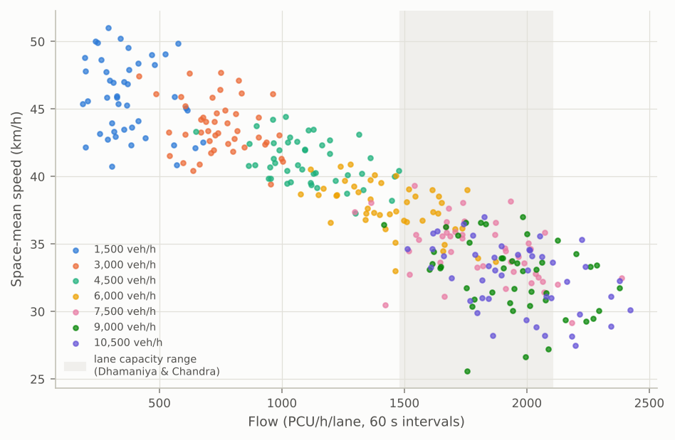
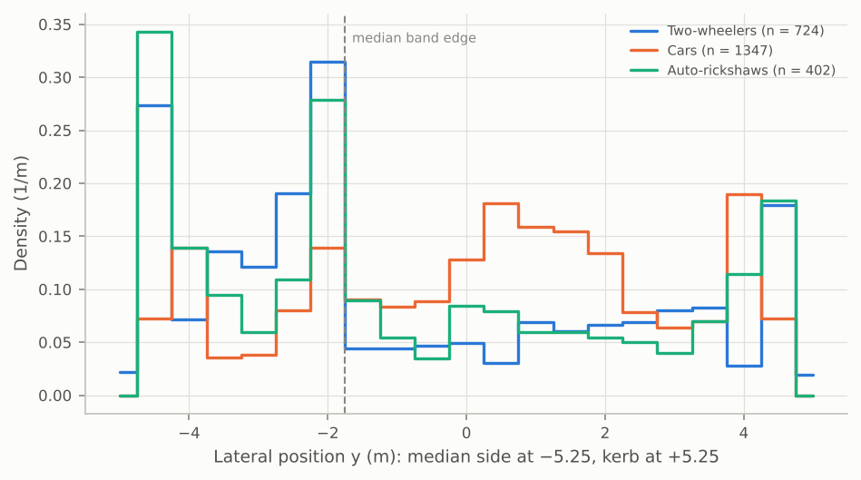
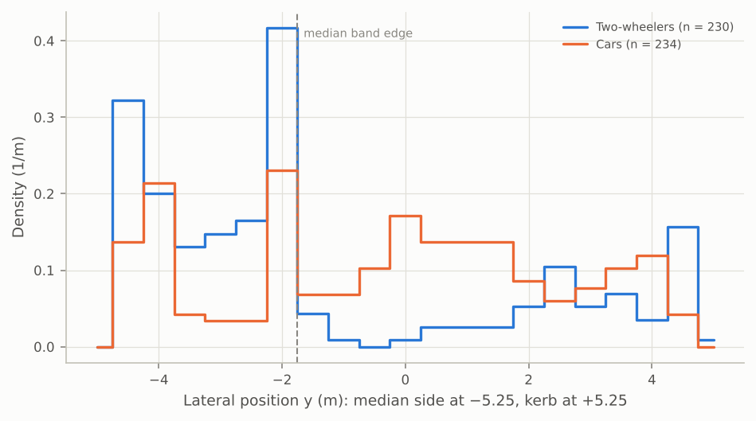

# P5 · Lateral behaviour: phase report

Generated by `scripts/p5_milestone.py` (and `scripts/p5_stage3_recovery.py`). Shipped register,
nothing tuned; the model is [ADR-0010](../../plan/decisions/ADR-0010-lateral-model.md).

## Milestone check

| Check (P5 card) | Result |
| --- | --- |
| Partial densities by class in the range of Kanagaraj & Treiber | 4 of 4 classes within ±20% at their medium total density (Two-wheelers, Cars, Buses, Auto-rickshaws); table below |
| Speed–flow points plausible against the capacity–speed curve | highest 60 s flow 2422 PCU/h/lane, 95th percentile 2184, against 1,482–2,105: plausible but high: the 95th percentile is 4% over the top of the range (inside its ±10% tolerance), the busiest minutes 15% over |
| Zero guard collisions | 0 guard events in 66,386,434 agent-steps over every run in this report |
| The viewer shows two-wheelers filtering and seeping | `reports/phases/P5/seepage.gif` (`node web/e2e/p5_seepage.cjs`) |
| Lateral histograms by class | figures below |

## Partial densities and speed–flow

A 1.5 km, 10.5 m corridor with Kanagaraj & Treiber's composition (density shares 2W 68%, car
22%, bus 4%, auto 6%, used as inflow shares), swept over demand; area detector 500–1,000 m, 60 s
intervals after a 300 s warm-up. Mean partial density (veh/km):

| Demand (veh/h) | Flow (veh/h) | Speed (km/h) | Waiting to enter | Total | Two-wheelers | Cars | Buses | Auto-rickshaws |
| --- | --- | --- | --- | --- | --- | --- | --- | --- |
| 1,500 | 1,479 | 45.9 | 0 | 32 | 22.6 | 5.6 | 1.9 | 2.2 |
| 3,000 | 2,983 | 43.7 | 0 | 68 | 45.6 | 13.9 | 3.7 | 5.3 |
| 4,500 | 4,545 | 41.1 | 0 | 111 | 72.7 | 25.0 | 5.3 | 7.8 |
| 6,000 | 6,043 | 37.7 | 0 | 161 | 104.3 | 37.7 | 7.9 | 11.0 |
| 7,500 | 7,589 | 34.6 | 4 | 221 | 141.1 | 53.9 | 10.9 | 15.2 |
| 9,000 | 8,655 | 32.6 | 125 | 268 | 172.5 | 66.5 | 10.8 | 18.5 |
| 10,500 | 8,479 | 32.6 | 613 | 263 | 167.8 | 65.8 | 11.5 | 17.8 |
| **K&T medium** | | | | **250** | **170** | **55** | **10** | **15** |
| at a total of 250 (interpolated) | | | | 250 | 160.4 (-6%) | 61.6 (+12%) | 10.8 (+8%) | 17.2 (+15%) |

Demand is an input here, swept and not fitted. Above about 8,500 veh/h vehicles wait to enter
(the entry, not the corridor, limits the flow), and the densities level off at K&T's medium total
of 250 veh/km. The last row interpolates each class at that total. Kanagaraj & Treiber's shares
are density shares; used as inflow shares, faster classes are slightly under-represented in
density.

Speeds fall with flow as they should, and the busiest minutes reach or pass the top of the range
of Dhamaniya & Chandra's Indian midblocks (flows in PCU with the midpoints of the register's
dynamic-PCU ranges, three notional lanes for 10.5 m). Because the entry limits the flow, this is
a lower bound on the simulated capacity: it is high, if anything. It is reported, not tuned
away: capacity is governed by the following model (time gaps and standstill gaps, stage 2, not
yet calibrated; the P3 Morris screen found them among the strongest factors) and by the
clearances (stage 3).

## Lateral positions by class

Reference corridor (`scenarios/corridor_2km.yaml`, seed 1, 1 h), crossings of the 1,000 m
screenline after warm-up:

| Class | Crossings | Mean y (m) | SD (m) |
| --- | --- | --- | --- |
| Two-wheelers | 724 | -0.84 | 3.03 |
| Cars | 1,347 | +0.30 | 2.57 |
| Auto-rickshaws | 402 | -0.79 | 3.10 |
| Buses | 56 | +0.15 | 2.94 |
| Bicycles | 22 | -1.93 | 4.10 |
| E-rickshaws | 42 | -1.64 | 3.96 |

Two things stand out. Two-wheelers spread wider than cars and sit nearer the median; cars keep
to the middle. And two-wheelers and autos pile up just inside the median band (3.5 m from the
median edge): its speed bonus (G§7.3) is a step, so being 1 cm inside it is worth the whole
bonus. Bicycles and e-rickshaws spend about half their time at the median edge for the same
reason (the bonus is additive, and large for slow classes). Both were noted in the interim
report and are not tuned away; a smooth band or class-specific entry positions (grade A once
measured) would change them, and that is a modelling choice for a later ADR.

Share of time with the body's edge within 0.75 m of the median or the kerb (1 Hz trajectories):

| Class | Median side | Kerb side |
| --- | --- | --- |
| Auto-rickshaws | 24% | 16% |
| Bicycles | 52% | 30% |
| Buses | 23% | 29% |
| Cars | 14% | 15% |
| E-rickshaws | 47% | 29% |
| LCVs | 12% | 21% |
| Trucks | 34% | 21% |
| Two-wheelers | 17% | 11% |

Moving-bottleneck scenario (`scenarios/moving_bottleneck_e_rickshaw.yaml`, 750 m screenline):

| Class | Crossings | Mean y (m) | SD (m) |
| --- | --- | --- | --- |
| Two-wheelers | 230 | -1.37 | 2.99 |
| Cars | 234 | -0.25 | 2.66 |
| E-rickshaws | 6 | +1.33 | 3.54 |

## P5.6 reference scenarios

**E-rickshaws at 21 km/h** in cars and two-wheelers: vehicles that pass an e-rickshaw, by side.

| Seed | E-rickshaws | Kerb side | Median side | Kerb share |
| --- | --- | --- | --- | --- |
| 1 | 8 | 141 | 277 | 34% |
| 2 | 18 | 463 | 415 | 53% |
| 3 | 10 | 246 | 251 | 49% |

**Barrier closed 120 s in every 300 s** (`scenarios/barrier_queue.yaml`): places gained between
joining the queue and the opening, mean per vehicle over the four closures (positive = moved
forward through the queue):

| Seed | Two-wheelers | Cars | Auto-rickshaws |
| --- | --- | --- | --- |
| 1 | +1.38 | -0.37 | -0.39 |
| 2 | +1.74 | -0.88 | +0.24 |
| 3 | +1.62 | -0.51 | -0.48 |

## Collision guard (P5.5)

P5.5 guard: 10000 scenarios, 210265551 agent-steps (up to 181 agents at once), 0 overlaps after the guard; 964509 guard events in 2050 scenarios = 4587.10 per 10^6 agent-steps; 964509 of the events in the 4086 scenarios whose road narrows

Every guard event in the property test comes from roads that narrow: the lateral model reads the
width only where a vehicle is. Reacting to width changes ahead is P6.1 work (card updated).

## Conflicts (P5.7)

Detection costs **3.9% of instructions and 4–7% of wall time** on the reference corridor
(callgrind; median and best of 8 interleaved timing rounds), measured by compiling the conflict
code out: the output hash is unchanged without it (conflicts do not feed back into the
dynamics). Budget: 15%.

## Stage 3 (P5.8)

**Outcome:** the clearance offset Δ and the steering scale are recovered well; the car–car
clearance intercept and the braking scale are recovered within their CIs but loosely; eight
stage-3 parameters do not move these statistics enough to be fitted from lateral data at all.
What to do with those is [ADR-0011](../../plan/decisions/ADR-0011-stage3-identifiability.md)
(proposed: demote them to `sweep`; your decision).

Tooling: `marg.stage3` (statistics and Wasserstein/KS distances), `Simulator(trajectories=True)`,
and `Stage.fit(method="response_surface")`, a Gauss–Newton fit on local linear regressions of the
moments. Finite differences fail here: under common random numbers the statistics are
deterministic but rough (a 0.1% parameter change moves a different set of vehicles), so the
least-squares fit lands in noise-made dips and its CIs miss (2 of 4 truths in a first try).

Statistics (from trajectories, so real trajectory data plug in unchanged):
lateral position at a section (mean, SD) and partial density by class, lateral metres per km,
and the gap to the nearest vehicle alongside (mean, SD, share under 1 m; pairs within 2.5 m as
Budhkar & Maurya). Scenario `scenarios/stage3_recovery.yaml`, 10 seeds per evaluation.
Standard errors are a delete-one-cluster jackknife over 60 s windows; two disjoint seed sets at
the same parameters differ by z with SD 1.03 (45 differences), so they are honest.

**Screen** (change between −25% and +25% of the register value, in standard errors):

| Parameter | max \|z\| | Strongest statistics |
| --- | --- | --- |
| `clearance.min_offset` | 30.6 | side_gap_mean (-30.6), side_gap_sd (+26.4) |
| `steering_scale` | 15.8 | side_gap_mean (+15.8), side_gap_tight_share (-7.1) |
| `clearance.pair.intercept.two_wheeler_car` | 10.6 | side_gap_mean (+10.6), side_gap_tight_share (-7.7) |
| `clearance.pair.intercept.car_car` | 7.4 | side_gap_mean (+7.4), side_gap_tight_share (-5.1) |
| `steering_sensitivity` | 6.2 | side_gap_mean (+6.2), side_gap_tight_share (-3.5) |
| `braking_scale` | 5.8 | side_gap_tight_share (-5.8), side_gap_sd (-4.4) |
| `comfort_weight` | 3.4 | side_gap_sd (-3.4), side_gap_tight_share (-2.1) |
| `clearance.pair.slope.car_car` | 2.8 | lateral_sd_car (+2.8), side_gap_mean (+1.6) |
| `time_constant` | 2.1 | lateral_per_km_car (-2.1), lateral_sd_auto_rickshaw (-1.5) |
| `switch_threshold` | 1.9 | side_gap_tight_share (+1.9), lateral_per_km_car (-1.9) |
| `move_cost` | 1.9 | side_gap_mean (-1.9), lateral_mean_car (-1.7) |
| `edge_clearance` | 1.4 | side_gap_sd (+1.4), lateral_sd_auto_rickshaw (-1.4) |
| `max_heading` | 1.1 | lateral_sd_car (-1.1), lateral_per_km_car (+0.6) |
| `politeness` | 1.1 | side_gap_sd (-1.1), lateral_per_km_car (-0.8) |
| `safe_decel` | 0.7 | lateral_per_km_two_wheeler (+0.7), side_gap_mean (+0.7) |
| `creep_speed.two_wheeler` | 0.0 | lateral_per_km_auto_rickshaw (-0.0), lateral_per_km_two_wheeler (-0.0) |

**Recovery** (truth simulated at seeds 101–110, fitted at seeds 1–10 from the
register's values, `method="response_surface"`, 187 evaluations, 12 min;
stopped after 187 evaluations):

| Parameter | Start | Truth | Estimate | 95% CI | Covered |
| --- | --- | --- | --- | --- | --- |
| `clearance.min_offset` | 117 | 100 | 99.5 | [88.7, 110] | yes |
| `clearance.pair.intercept.car_car` | 117 | 130 | 104 | [55.9, 151] | yes |
| `steering_scale` | 0.3 | 0.38 | 0.404 | [0.345, 0.463] | yes |
| `braking_scale` | 0.15 | 0.12 | 0.155 | [0.0721, 0.237] | yes |

## Performance (P5.9)

**903 ns per agent-step** (median of 5 runs, best 841; 5,062,218 agent-steps; 787× real time) on one core of `Intel(R) Xeon(R) Processor @ 2.10GHz`; output hash `ef22e8c646ee`.

**Budget: 555 ns per agent-step. Not met on this machine.** Before this session's work the same
machine measured 1,047 ns on the first 600 s of the corridor and about 1,100 ns on the hour
(median of interleaved runs; the VM's timing noise is about ±10%). The optimisations change no
result (the output hash is identical; a property test compares the batched, pruned choice with
one-candidate-at-a-time scoring on 4,096 random scenes):

| Change | Effect |
| --- | --- |
| Score lateral candidates in batches, neighbour by neighbour | 1,084 → 910 ns (600 s, best of 7) |
| Two-stage scoring: drop candidates whose exact utility bound cannot beat the threshold | 20.3 → 5.3 candidates fully scored per decision |
| Reuse a per-thread neighbour list (no 5 KB zeroing per decision) | decision time −6 to −9% |
| Insertion sort for the nearly sorted orders; batched state hashing; no allocation in compaction | hash and compaction about −65% |
| Skip the no-cut-in division beyond any possible closing gap | −4% |
| All together | 1,047 → 810 ns (600 s, median of 5 interleaved rounds) |

Profile now (600 s, 3.6 G instructions): lateral decisions about half of the wall time (2.6 µs
each, on 21% of agent-steps), the per-step neighbour scan about 39%, everything else about 10%.
This machine is a shared 2.1 GHz Xeon; the P2 figure (90 ns) was measured on a laptop core that
ran the P2 code 1.37× faster than this one (123 ns here), so the hour here corresponds to roughly
661 ns there. Further gains need either a change the model sees, or deeper restructuring of
the scan (one pass shared by following, side limits and decision gathering). The options are
listed in STATUS.md for your call: the decision interval `core.decision_interval` (0.5 s) and the
candidate step `core.lateral_candidate_step` (0.25 m) are numerical settings, but changing them
changes behaviour, so not without an ADR.

Reference corridor KPIs (seed 1, 1 h): throughput 2,947 veh/h,
mean delay 29.6 s, mean speed 11.3 m/s,
373 conflict episodes, 112,642 lateral moves.
