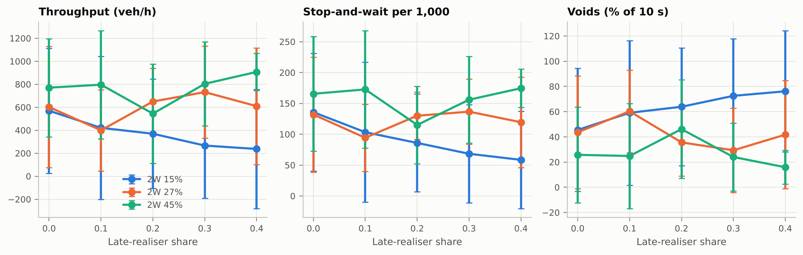

# P7 milestone: junctions, splits and gap acceptance

Generated by `scripts/p7_milestone.py` (P7.3 from `scripts/p7_signal_check.py`, P7.4 from
`scripts/p7_gap_recovery.py`). Nothing here was tuned towards a target.

**Read this first.** The guide has no Indian study of late crossing at splits, no U-turn
path parameters that could be read here, and no roundabout numbers: the inputs of
sections 1, 3 and 5 are placeholders (in the scenarios' `overrides`). Two things in this
report need your decision before the split experiment means much: the forms ADR-0017
proposed for when drivers move over and how a stop-and-wait ends (section 1), and how
vehicles on a ring are arbitrated (section 5, ADR-0009).

## 1. The split experiment (milestone)

`scenarios/split_corridor.yaml`: 700 m of 10.5 m carriageway, then a kerb-side branch
(55%) and a median-side branch (45%), each 5.25 m. Vehicles enter at their class's usual
lateral position whatever branch they need. Late realisers learn their branch 20-120 m
before the split, or from the sign at 80 m unless a bus, truck or tractor is in front;
everyone else knows it from the entry. At its deadline a driver on the wrong side stops
to wait with probability 0.5, otherwise it gives up and takes the branch it is in.
5 seeds per point, 30 min (5 min warm-up); ± is a 95% CI over seeds.
Collision-guard events in all 100 runs: **22**.

### At 1,000 veh/h (in a single seed, the stream flowed without late realisers)

| 2W share | Late realisers | Throughput (veh/h) | Stop-and-wait /1000 | Give-up /1000 | Voids (10 s, %) | Gridlock (runs) |
| --- | --- | --- | --- | --- | --- | --- |
| 0.15 | 0.0 | 570 ± 544 | 135.8 ± 95.5 | 122.6 ± 98.1 | 45.5 ± 48.8 | 3/5 |
| 0.15 | 0.1 | 421 ± 621 | 103.3 ± 113.4 | 100.5 ± 114.3 | 59.1 ± 57.4 | 3/5 |
| 0.15 | 0.2 | 370 ± 476 | 86.0 ± 79.1 | 90.6 ± 90.8 | 63.9 ± 46.8 | 4/5 |
| 0.15 | 0.3 | 267 ± 458 | 68.4 ± 79.3 | 66.1 ± 80.0 | 72.5 ± 45.4 | 4/5 |
| 0.15 | 0.4 | 237 ± 519 | 58.5 ± 79.0 | 54.8 ± 76.1 | 76.1 ± 48.1 | 4/5 |
| 0.27 | 0.0 | 602 ± 527 | 131.9 ± 93.2 | 132.6 ± 94.8 | 43.6 ± 44.7 | 3/5 |
| 0.27 | 0.1 | 399 ± 353 | 94.3 ± 54.2 | 96.2 ± 68.9 | 60.3 ± 32.8 | 5/5 |
| 0.27 | 0.2 | 650 ± 290 | 130.0 ± 38.2 | 132.9 ± 45.5 | 35.6 ± 26.8 | 4/5 |
| 0.27 | 0.3 | 732 ± 400 | 136.6 ± 53.0 | 144.1 ± 60.4 | 29.3 ± 33.4 | 2/5 |
| 0.27 | 0.4 | 610 ± 506 | 119.5 ± 73.3 | 119.9 ± 80.9 | 41.7 ± 43.0 | 3/5 |
| 0.45 | 0.0 | 770 ± 427 | 165.6 ± 93.2 | 167.5 ± 84.0 | 25.7 ± 38.0 | 2/5 |
| 0.45 | 0.1 | 796 ± 470 | 172.7 ± 95.2 | 173.1 ± 91.2 | 24.8 ± 41.7 | 1/5 |
| 0.45 | 0.2 | 544 ± 431 | 115.1 ± 62.8 | 124.3 ± 94.4 | 46.1 ± 39.2 | 4/5 |
| 0.45 | 0.3 | 804 ± 364 | 156.0 ± 70.5 | 167.7 ± 67.8 | 24.0 ± 26.9 | 2/5 |
| 0.45 | 0.4 | 907 ± 161 | 174.6 ± 30.9 | 173.9 ± 28.0 | 15.9 ± 13.4 | 1/5 |

Rank correlation with the late-realiser share over runs (Spearman ρ, p):

| 2W share | Throughput | Stop-and-wait | Voids |
| --- | --- | --- | --- |
| 0.15 | -0.25 (0.220) | -0.38 (0.062) | +0.26 (0.213) |
| 0.27 | +0.12 (0.556) | +0.07 (0.737) | -0.19 (0.362) |
| 0.45 | +0.02 (0.933) | -0.01 (0.963) | +0.00 (0.993) |

### At 1,200 veh/h: the onset of gridlock

Gridlock (plan 04 §3, now built): an area detector's space-mean speed below
`observers.gridlock.speed` (5 km/h) for `observers.gridlock.duration` (60 s). Onset is
the start of the first such spell.

| Late realisers | Runs gridlocked | Onset (s), median [min, max] | Gridlock share of time | Throughput (veh/h) |
| --- | --- | --- | --- | --- |
| 0.0 | 5/5 | 761 [541, 1568] | 0.50 ± 0.36 | 402 ± 397 |
| 0.1 | 5/5 | 720 [499, 1566] | 0.60 ± 0.36 | 280 ± 422 |
| 0.2 | 5/5 | 789 [508, 1565] | 0.54 ± 0.33 | 379 ± 368 |
| 0.3 | 4/5 | 1145 [535, 1671] | 0.33 ± 0.49 | 640 ± 583 |
| 0.4 | 4/5 | 1168 [427, 1669] | 0.34 ± 0.49 | 633 ± 597 |

## 2. Gap acceptance (P7.4): critical gaps back out of the simulation

`scripts/p7_gap_recovery.py`: the priority crossing with no heavy vehicles, major road
300 veh/h each way, minor 150 veh/h,
4 seeds × 3600 s. Every gap a waiting driver turns down is now
logged (`gap_rejected`) beside the one it takes; `marg.gaps` estimates the critical-gap
population from them. *Drawn* is the critical gaps the deciding drivers actually drew.

| Class | Drivers | Register (median / σ) | Drawn | MLE median (z vs drawn) | MLE σ | Raff |
| --- | --- | --- | --- | --- | --- | --- |
| two_wheeler | 800 | 4.4 / 0.2 | 4.427 / 0.204 | 4.385 ± 0.07 (-0.6) | 0.209 ± 0.014 | 4.547 |
| auto_rickshaw | 307 | 6.8 / 0.2 | 6.869 / 0.209 | 6.333 ± 0.185 (-2.9) | 0.218 ± 0.024 | 6.409 |
| car | 521 | 8.15 / 0.2 | 8.12 / 0.194 | 7.959 ± 0.186 (-0.9) | 0.167 ± 0.021 | 7.753 |

## 3. U-turns at a median opening (P7.5)

`scenarios/median_opening.yaml`, half of each direction U-turning, 500 veh/h each way.
Where a U-turner joins the receiving carriageway is drawn from the four-lane path below
six notional lanes of receiving width (10.5 m) and from the six-lane one at or above it.
Both are placeholders (Mohapatra, Dey & Chandra 2016 could not be read): a gamma
(2.5, 0.8 m) and a mixture 0.6 Gamma(4, 0.3 m) + 0.4 N(5.5, 0.8 m).

| Road | Receiving width | U-turns | Mean (m) | SD (m) | < 2.5 m | 3-4 m | 4-8 m | Guard events |
| --- | --- | --- | --- | --- | --- | --- | --- | --- |
| four-lane | 7.0 m | 155 | 1.92 | 1.19 | 0.755 | 0.135 | 0.052 | 1 |
| six-lane | 10.5 m | 161 | 3.03 | 2.25 | 0.54 | 0.012 | 0.422 | 1 |

## 4. Entries fed through a signal (P7.7)

`scenarios/upstream_signal.yaml`: 1,000 veh/h, a 90 s cycle with 40 s green and 3 s amber.
Headways where vehicles cross station 300 m (100 m past the simulated stop line), from 300 s.

| Feed | Headways | Mean (s) | CV | Share below 1.5 s | Gaps over 25 s |
| --- | --- | --- | --- | --- | --- |
| renewal | 418 | 3.56 | 0.95 | 0.306 | 0 |
| simulated stop line at 200 m | 397 | 3.64 | 2.98 | 0.673 | 16 |
| entry held unless green | 422 | 3.49 | 2.15 | 0.526 | 15 |

## 5. Roundabouts (P7.8)

`scenarios/roundabout.yaml`: ring radius 16 m, ring width 8 m, stop lines 4 m outside it,
every turn (60% through). Three seeds per flow, 30 min.

| Flow per arm (veh/h) | Seed | Spawned | Exited | Still in the network | Guard events |
| --- | --- | --- | --- | --- | --- |
| 150 | 1 | 307 | 295 | 12 | 8 |
| 150 | 2 | 293 | 282 | 11 | 15 |
| 150 | 3 | 332 | 320 | 12 | 0 |
| 300 | 1 | 581 | 288 | 293 | 15 |
| 300 | 2 | 570 | 523 | 47 | 1035 |
| 300 | 3 | 584 | 566 | 18 | 0 |
| 500 | 1 | 965 | 302 | 663 | 62 |
| 500 | 2 | 932 | 79 | 853 | 15708 |
| 500 | 3 | 888 | 31 | 857 | 0 |

## 6. Signals (P7.3, from P7_signal.json)

`scenarios/signal_crossing.yaml`, every turn at 700 veh/h per arm (unchanged by this phase:
the box scenarios give the same output hashes as before it).

| Approach | Cycles | Saturation flow (veh/h) | Per metre of width |
| --- | --- | --- | --- |
| e | 21 | 1492 | 213 |
| n | 25 | 1933 | 276 |
| s | 27 | 2033 | 290 |
| w | 24 | 1630 | 233 |

| Class | Discharge acceleration (m/s²) | Check (G§1) | Within ±20% |
| --- | --- | --- | --- |
| two_wheeler | 0.90 (n 389) | 0.6 | no |
| three_wheeler | 0.42 (n 160) | 0.43 | yes |
| car | 0.49 (n 251) | 0.49 | yes |
| lcv | 0.46 (n 27) | 0.46 | yes |

## Findings

1. **The split experiment does not show what P7.6 asks for, and the cause is in the model,
   not in the sweep.** At 1,000 veh/h with *no* late realisers, about 13% of drivers reach
   their deadline on the wrong side and stop to wait, as many again give up, and the split
   gridlocks in most runs (3 of 5 at the base two-wheeler share). Raising the late-realiser
   share from 0 to 0.4 moves none of throughput, stop-and-wait or voids significantly at any
   two-wheeler share (|ρ| ≤ 0.38, p ≥ 0.06; the counts are also confounded by gridlock, since
   a locked run sends fewer drivers to the split), and at 1,200 veh/h almost every run
   gridlocks whatever the share. Three forms of ADR-0017, now run for the first time, cause
   this; the options are in ADR-0017 and need your decision:
   - *Drivers who know their branch move over late.* The pull towards the branch acts only
     within the 150 m lookahead, and it is proportional to urgency, which stays near zero
     until the move is nearly impossible (û = Δy / (tan θ_max × distance left)). In single
     runs at 1,000 veh/h with no late realisers, 44% of drivers were on the wrong side at
     their deadline with the placeholder `w_route` = 1, and still 28% at the register's
     maximum of 20.
   - *A stop-and-wait never ends.* Two waiting drivers who need each other's side block each
     other for good, and the road behind them locks: the gridlocks start there.
   - *A late realiser who has not learnt its branch by its deadline does not stop* (it does
     not know): more late realisers turn would-be stoppages into missed branches. Missed
     branches rise with the share only with 45% two-wheelers (ρ = +0.48, p = 0.015).
2. **More two-wheelers make the split work better.** Averaged over the late-realiser shares,
   throughput is 373, 598 and 764 veh/h at 15%, 27% and 45% two-wheelers, voids 63%, 42% and
   27% of 10 s intervals, gridlock in 72%, 68% and 40% of runs: two-wheelers filter past the
   waiting cars. All inputs are placeholders: this says what the mechanisms do, not what
   Delhi does.
3. **Gap acceptance (P7.4).** The maximum-likelihood estimate recovers two-wheelers and cars
   within about one standard error of the critical gaps they drew, auto-rickshaws 8% low
   (z −2.9); with busier major streams the low bias grows (cars −5% at 600 veh/h each way).
   The core re-reads a gap at every step as a driver approaches (the forecast lag rises as it
   nears its line), so a driver that takes a gap on the move takes it the moment the forecast
   reaches its critical gap. The logged gap then sits at the critical gap, not at the fixed
   gap a survey records, and the estimator, which assumes fixed gaps, comes out low.
   Restricting to drivers who stood at the line did not remove it. **For your decision:** the
   register's critical gaps are Abhigna et al.'s clearing-behaviour values (4.4–10.75 s); the
   same paper's Raff values, from the same data, are 2.3–4.8 s, and the paper calls the
   clearing-behaviour value "the safest critical gap". The register uses it as each driver's
   decision threshold, which is why compliant turns are the bottleneck at the signal crossing
   (ADR-0016 open problem 4).
4. **U-turns (P7.5)** follow the road-width rule: on the four-lane road the paths have mean
   1.92 m and SD 1.19 m (the gamma's 2.0 and 1.26); on the six-lane road they are bimodal, with
   1% of paths between the modes. One collision-guard event in each 30 min run.
5. **Entries fed through a signal (P7.7)** arrive in platoons: the coefficient of variation
   of headways is 2.98 (simulated stop line) and 2.15 (entry held) against 0.95 for the
   renewal entry, with one gap over 25 s per cycle (16 and 15 in 1,500 s of 90 s cycles)
   against none.
6. **Roundabouts (P7.8)** carry light traffic (150 veh/h per arm: every seed flows, 0–15
   guard events in 30 min) and lock at 300–500 veh/h per arm. The geometry was wrong in ways
   that are now fixed and tested (ADR-0009 addendum); what remains is that the junction
   arbitration of decision D, built for a box that vehicles cross, does not carry over to a
   ring where every vehicle is always inside the junction. Options in ADR-0009, for your
   decision.

