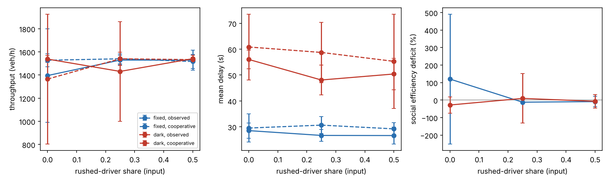

# P8 report: personas, violations, imitation and signal control states

Generated by `scripts/p8_milestone.py` from the shipped register. Every rule coefficient
is assumed (the guide gives none, G§4.1 grade C) and was not tuned towards any check:

| Coefficient | Value |
| --- | --- |
| `violations.coefficients.aggressiveness` | 0.5 |
| `violations.coefficients.time_saved` | 0.05 |
| `violations.coefficients.waiting_time` | 0.08 |
| `violations.coefficients.imitation_violators` | 0.5 |
| `violations.coefficients.imitation_compliers` | 0.2 |
| `violations.coefficients.enforcement` | 1.0 |
| `violations.coefficients.risk` | 2.0 |
| `violations.forced_entry.intercept` | -5.0 |
| `violations.box_blocking.intercept` | -5.0 |
| `violations.amber_go.intercept` | -1.0 |
| `violations.red_light.intercept` | -8.105 (fitted, step 1) |
| `violations.early_start.intercept` | -8.105 (= red light's, assumed) |

Signal crossing at 400 veh/h per arm, every turn, 1800 s with 300 s
warm-up, 5 seeds per point (95% CIs over seeds).

## 1. P8.5: fitting the red-light intercept to 1 in 17

Drivers facing red: stop-line crossings by vehicles that had queued at the line or
crossed on red. Runs: crossings on red by a `red_light` act. No countdown.

| Intercept tried | Share running red |
| --- | --- |
| -8.000 | 6.22% |
| -11.000 | 2.44% |
| -9.500 | 3.86% |
| -8.750 | 3.41% |
| -8.375 | 4.59% |
| -8.188 | 5.03% |
| -8.094 | 7.21% |
| -8.141 | 5.41% |
| -8.117 | 5.59% |

**Fitted: β0 = -8.105**, share 5.95% (103 of 1732; target 5.88%; locked runs at the fitted value: 0 of 5).

**Check, not fitted: where in the red they run** (time since red began over the red's
length; Mumbai: a third just after red starts, two-thirds just before green):

| First third | Middle third | Last third |
| --- | --- | --- |
| 31% | 24% | 45% |

Histogram by tenth of the red: 4, 15, 12, 7, 10, 5, 8, 9, 16, 17

## 2. P8.5: the countdown

Share of cycles (arm × cycle) with at least one crossing on red in the first or last
third of the red. Sharma et al. 2012 (Chennai), with timers: end of red 12% → 75%,
start of red 59% → 31%.

| Countdown | Cycles | Start of red | End of red | Share running red | Early starts per run | Locked runs |
| --- | --- | --- | --- | --- | --- | --- |
| none | 820 | 5.4 ± 1.9% | 8.9 ± 3.4% | 7.50 ± 4.46% | 0.0 ± 0.0 | 1 |
| working | 820 | 6.8 ± 2.9% | 7.7 ± 3.2% | 7.94 ± 4.66% | 2.3 ± 1.8 | 1 |
| working, early start β0 +3 | 820 | 4.6 ± 1.5% | 20.4 ± 4.7% | 8.24 ± 1.33% | 32.6 ± 6.5 | 1 |
| working, early start β0 +6 | 820 | 5.2 ± 1.9% | 50.1 ± 5.6% | 21.13 ± 2.50% | 109.7 ± 10.4 | 0 |

## 3. P8.6: imitation

`early_start` alone, working countdown: acts per episode (a front vehicle standing in
the change interval before its green).

| βs⁺ | βs⁻ = 0.0 | βs⁻ = 1.0 |
| --- | --- | --- |
| 0.0 | 5.6 ± 2.3% (10/187) | 3.8 ± 1.4% (7/190) |
| 1.0 | 5.3 ± 1.7% (10/190) | 3.9 ± 1.4% (7/191) |
| 2.0 | 6.5 ± 2.2% (12/186) | 3.8 ± 1.4% (7/189) |
| 3.0 | 7.4 ± 1.8% (13/181) | 4.5 ± 2.3% (8/187) |
| 4.0 | 7.5 ± 3.4% (14/187) | 6.5 ± 3.1% (12/186) |
| 6.0 | 9.9 ± 5.9% (18/184) | 8.8 ± 2.9% (15/180) |
| 8.0 | 8.5 ± 4.4% (16/186) | 10.2 ± 7.9% (13/163) |
| 10.0 | 9.9 ± 3.4% (19/194) | 9.1 ± 4.9% (18/191) |

## 4. P8.8: persona shares

Every rule on, working countdown. Delivery-rider share as input (within two-wheelers,
realised in brackets) against the e-rickshaw share of the stream. Means over the runs
that did not lock (a locked run: less than half the demand leaves the junction).

| Delivery | E-rickshaw | Throughput (veh/h) | Mean delay (s) | Violations /1000 veh | Red runs /1000 veh | Conflicts /1000 veh | Locked runs |
| --- | --- | --- | --- | --- | --- | --- | --- |
| 0.0 (0%) | 0.03 | 1526 ± 102 | 27.9 ± 8.5 | 70.2 ± 22.0 | 37.1 ± 23.9 | 236.2 ± 88.5 | 0 of 3 |
| 0.0 (0%) | 0.1 | 1523 ± 59 | 27.1 ± 7.4 | 70.7 ± 48.1 | 36.0 ± 26.0 | 198.5 ± 115.2 | 0 of 3 |
| 0.0 (0%) | 0.2 | 1518 ± 97 | 27.0 ± 8.1 | 63.6 ± 22.7 | 29.2 ± 12.4 | 192.4 ± 43.0 | 0 of 3 |
| 0.15 (14%) | 0.03 | 1518 ± 85 | 27.9 ± 6.6 | 71.1 ± 37.5 | 40.1 ± 32.1 | 230.4 ± 62.5 | 0 of 3 |
| 0.15 (14%) | 0.1 | 1523 ± 50 | 27.4 ± 6.5 | 73.6 ± 42.2 | 39.0 ± 35.4 | 192.6 ± 45.4 | 0 of 3 |
| 0.15 (14%) | 0.2 | 1517 ± 78 | 26.8 ± 6.4 | 72.7 ± 13.8 | 37.0 ± 10.5 | 180.6 ± 31.7 | 0 of 3 |
| 0.3 (30%) | 0.03 | 1529 ± 123 | 27.0 ± 4.7 | 67.0 ± 22.5 | 36.5 ± 8.8 | 214.9 ± 49.3 | 0 of 3 |
| 0.3 (30%) | 0.1 | 1519 ± 61 | 27.8 ± 4.2 | 89.6 ± 68.6 | 47.7 ± 46.4 | 185.6 ± 317.0 | 1 of 3 |
| 0.3 (29%) | 0.2 | 1519 ± 78 | 26.0 ± 7.4 | 67.0 ± 37.0 | 31.8 ± 11.9 | 157.9 ± 15.8 | 0 of 3 |

## 5. P8.4: the new types

**Stop-line seepage** (intercept -3.0, assumed; the other types off), the same
crossing, 8 seeds: median saturation flow per metre of approach over the
measured cycles (P7.3's measure, over vehicles that did not cross on red). G§4.2:
vehicles standing past the line raise it (Ramireddy et al. 2020; a check). Means over
the runs that did not lock.

| Seepage | Saturation flow (veh/h/m) | Seepages per run | Mean delay (s) | Locked runs | Runs with a pair held by the guard |
| --- | --- | --- | --- | --- | --- |
| off | 227 ± 34 | 0.0 ± 0.0 | 30.7 ± 2.7 | 0 of 8 | 0 |
| on | 246 ± 85 | 239.0 ± 12.4 | 31.9 ± 2.1 | 1 of 8 | 2 |

**Opposite-carriageway encroachment at a level crossing**
(`scenarios/undivided_level_crossing.yaml`: an undivided road, 3.5 m each way; the
barrier closes the eastbound side 90 s in every 180 s; 1,200 veh/h east, 500 west).

| Intercept | Encroachments /1000 veh | Vehicles through (of those in) | Mean delay (s) | Gridlock share | Conflicts /1000 veh | Guard events |
| --- | --- | --- | --- | --- | --- | --- |
| off | 0.0 ± 0.0 | 86 ± 3% | 34.5 ± 1.7 | 0.00 ± 0.00 | 353.7 ± 63.2 | 0.0 ± 0.0 |
| -10.0 | 66.8 ± 137.4 | 73 ± 33% | 49.1 ± 14.6 | 0.10 ± 0.28 | 928.6 ± 901.5 | 1.0 ± 2.8 |
| -8.0 | 255.7 ± 224.2 | 42 ± 41% | 51.1 ± 12.4 | 0.38 ± 0.37 | 1614.3 ± 834.8 | 440.6 ± 1141.8 |
| -6.0 | 483.4 ± 148.4 | 20 ± 17% | 43.5 ± 7.6 | 0.50 ± 0.36 | 2175.1 ± 466.9 | 32.6 ± 90.5 |

## 6. Milestone: the dark-signal experiment

Identical demand and personas; the crossing working (fixed plan, countdown) or dark from
the start; each against its cooperative twin. SED: excess of total delay (on the road and
waiting to enter) over the twin's, over the seeds where neither arm locked (pairs in
brackets). Means over the runs that did not lock; locked runs counted apart (less than
half the demand leaves the junction: the P7.2 robustness limit, in both arms). Gridlock
indicator: runs in which an approach's last 60 m stayed slow for the register's gridlock
duration.

| Rushed share | State | Arm | Throughput (veh/h) | Mean delay (s) | Conflicts /1000 veh | Violations /1000 veh | Gridlock indicator | Locked runs | SED |
| --- | --- | --- | --- | --- | --- | --- | --- | --- | --- |
| 0.0 (0%) | fixed | observed | 1395 ± 403 | 28.5 ± 2.9 | 320.0 ± 171.5 | 64.6 ± 8.7 | 1 of 5 | 0 | 120.0 ± 371.1% (4) |
| 0.0 (0%) | fixed | cooperative | 1528 ± 56 | 29.5 ± 5.5 | 242.8 ± 71.5 | 0.0 ± 0.0 | 2 of 5 | 1 |  |
| 0.0 (0%) | dark | observed | 1538 ± 29 | 56.0 ± 3.6 | 638.3 ± 56.9 | 361.5 ± 60.0 | 5 of 5 | 1 | -28.1 ± 47.0% (4) |
| 0.0 (0%) | dark | cooperative | 1365 ± 561 | 60.8 ± 12.7 | 753.7 ± 93.5 | 0.0 ± 0.0 | 5 of 5 | 1 |  |
| 0.25 (20%) | fixed | observed | 1529 ± 41 | 26.7 ± 2.3 | 216.9 ± 26.4 | 74.8 ± 11.7 | 0 of 5 | 0 | -12.0 ± 3.6% (5) |
| 0.25 (20%) | fixed | cooperative | 1540 ± 43 | 30.6 ± 3.2 | 256.4 ± 41.5 | 0.0 ± 0.0 | 2 of 5 | 0 |  |
| 0.25 (20%) | dark | observed | 1431 ± 430 | 48.1 ± 5.7 | 563.7 ± 158.8 | 354.6 ± 82.4 | 5 of 5 | 2 | 9.7 ± 141.7% (3) |
| 0.25 (20%) | dark | cooperative | 1540 ± 57 | 58.7 ± 11.7 | 597.2 ± 105.2 | 0.0 ± 0.0 | 5 of 5 | 0 |  |
| 0.5 (41%) | fixed | observed | 1529 ± 86 | 26.6 ± 3.3 | 234.3 ± 33.3 | 97.6 ± 35.4 | 2 of 5 | 2 | -8.7 ± 30.3% (2) |
| 0.5 (40%) | fixed | cooperative | 1517 ± 61 | 29.2 ± 2.4 | 255.2 ± 3.1 | 0.0 ± 0.0 | 2 of 5 | 2 |  |
| 0.5 (40%) | dark | observed | 1541 ± 30 | 50.4 ± 6.1 | 610.4 ± 79.5 | 412.2 ± 37.8 | 5 of 5 | 0 | -7.0 ± 39.5% (4) |
| 0.5 (40%) | dark | cooperative | 1533 ± 21 | 55.3 ± 18.2 | 564.8 ± 174.3 | 0.0 ± 0.0 | 5 of 5 | 1 |  |

## Findings

Nothing below was tuned. The coefficients are assumed, and only the red-light intercept was
fitted, to its rate. Since the previous report the code changed in six ways (the user's
decisions of 2026-11-16):

- the cooperative twin takes turns at a dark junction, first come first served (ADR-0019 D1);
- the field of view is measured from mid-length (ADR-0018);
- the left-hook rules (ADR-0016 open problem 3);
- the split options A2, B2 and C2 (ADR-0017);
- the delivery-rider share is exact within two-wheelers (`marg.templates`);
- the new violation types (ADR-0020);
- at amber onset, a vehicle that can still stop loses any gate it had (ADR-0016).

1. **P8.5, rate.** The red-light intercept fits 1 in 17, but noisily.
   - The share is not monotone in β0 near the fit (−8.094 gives 7.2%, −8.141 gives 5.4%).
     Runners change the traffic around them: who is at the front, imitation, locked runs.
   - β0 = −8.11 gave 6.0% against the 5.9% target. Treat the fit as β0 ≈ −8.1 ± 0.1. It was
     −7.68 before the left-hook rules and the closed gates at amber (ADR-0016) changed the
     junction's traffic.
2. **P8.5, timing regimes (a check): partly met.**
   - 31% of red runs fall in the first third of the red, 24% in the middle and 45% in the
     last. Mumbai has about a third and two-thirds.
   - The after-red-starts regime emerges: time saved is largest and the cross streams are
     still in their all-red.
   - The before-green regime is weaker than observed. Its terms are the cross streams
     emptying at their amber and all-red, and waiting time.
3. **P8.5, countdown (a check): not met with equal intercepts.**
   - With a working countdown and the early-start intercept equal to the red-light one, the
     start and end of red barely move (5.4% → 6.8%, 8.9% → 7.7%). Early starts are rare
     (about 2 per run).
   - 3 or 6 above the red-light intercept gives 20% and 50% at the end of red, with the start
     of red at 4.6% and 5.2%: the mechanism can produce Sharma's shift.
   - Sharma's 12% → 75% would need early start to be far more likely, per second, than
     running the red. That is a calibration question (stage 6).
4. **P8.6, imitation (done-when still not met).** With the field of view measured from
   mid-length, the early-start share rises from 5.6% at βs⁺ = 0 to about 10% at βs⁺ ≥ 6
   (3.8% → 9–10% with βs⁻ = 1). It roughly doubles, then levels off, with no sharp tipping.
   βs⁻ = 1 lowers it at 7 of 8 points, mostly inside the CIs.
   - An early-start episode lasts at most the 5 s change interval, and only vehicles standing
     at the front of the line are in one. Few are in view of each other at once, and a crowd
     to tip does not form.
   - What could: early start decided further back in the queue, or a longer window (W2 in
     ADR-0019). Both are modelling choices, for review.
5. **P8.8, persona shares** (now `marg.templates.persona_shares`).
   - Violations per 1,000 vehicles do not move measurably with the delivery-rider share:
     64–71 at 0, 67–90 at 30% of two-wheelers, with wide CIs (3 seeds per point). The
     previous report's rise (65–78 → 81–97) is within the noise.
   - Delay (about 27 s) and throughput do not move measurably with either share.
   - E-rickshaws (3–20% of the stream) change nothing at this junction.
6. **P8.4, the new types.**
   - **Seepage (check not met).** About 240 vehicles a run crept past a red line. The
     saturation flow measured at the line rose from 227 ± 34 to 246 ± 85 veh/h/m, G§4.2's
     direction but well inside the CI.
     - The measure counts the queue crossing the line at green. A vehicle already past the
       line is not in it, and the queue behind starts no sooner.
     - A head start measured where the field counts it (Ramireddy et al.) needs their
       definition of the discharge; not built.
     - Locked runs: 0 of 8 without seepage, 1 of 8 with it. 2 of 8 held a pair in the guard.
   - **Opposite encroachment at a level crossing: a negative-sum game.**
     - Each encroacher saves itself the queue, and everyone loses: vehicles through 86% →
       73%, 42%, 20% as the intercept rises, gridlock share 0 → 0.10, 0.38, 0.50, conflicts
       three to six times as many.
     - When the gate opens, the two streams meet head on with nowhere to go (vehicles cannot
       reverse in the model), as at Indian level crossings.
     - At −8 a run can hold a head-on pair in the collision guard (441 ± 1,142 events per run).
7. **Milestone: the dark-signal experiment, with the coordinated twin (D1).**
   - **Dark.** Violations (forced entries, 350–410 per 1,000 vehicles) no longer clearly cut
     delay: SED −28 ± 47%, +10 ± 142%, −7 ± 40% for rushed shares 0, 0.25 and 0.5. Every CI
     spans zero. The previous report's −73% to −81% came from a twin that waited for gaps that
     rarely came.
   - Taking turns, the twin serves the same throughput at 55–61 s of mean delay, against
     48–56 s observed, with about as many conflicts per vehicle. At 400 veh/h per arm, the
     agreed order is about as slow as the Chicken of the observed drivers.
   - **The guide's negative-sum game does not appear at the dark junction.** It does appear
     at the level crossing (6).
   - **Fixed signal.**
     - With a quarter of drivers rushed, red-light running cuts delay by 12 ± 4% (5 pairs).
     - With none, the SED is +120 ± 371%: one observed run nearly locked (818 veh/h, just
       above the lock threshold).
     - With half rushed, −9 ± 30% over the 2 pairs that did not lock.
8. **Robustness.**
   - The dark runs' guard loops are gone after the left-hook rules: at most 6 guard events
     per run, against 40,318 and 4,652 before.
   - Junction lock-ups at 400 veh/h remain (ADR-0016 open problem 1), in every arm: 0–2 of 5
     runs.
   - One fixed-signal run with red runners held a pair in the guard (23,078 events).
   - A gap taken far upstream for a wait inside the box no longer opens a line that turns red
     (ADR-0016): without violations nobody now crosses on red but those that could not stop.
